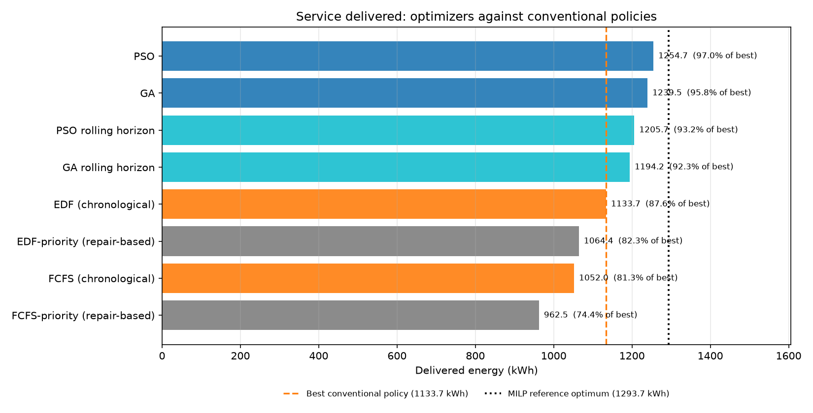
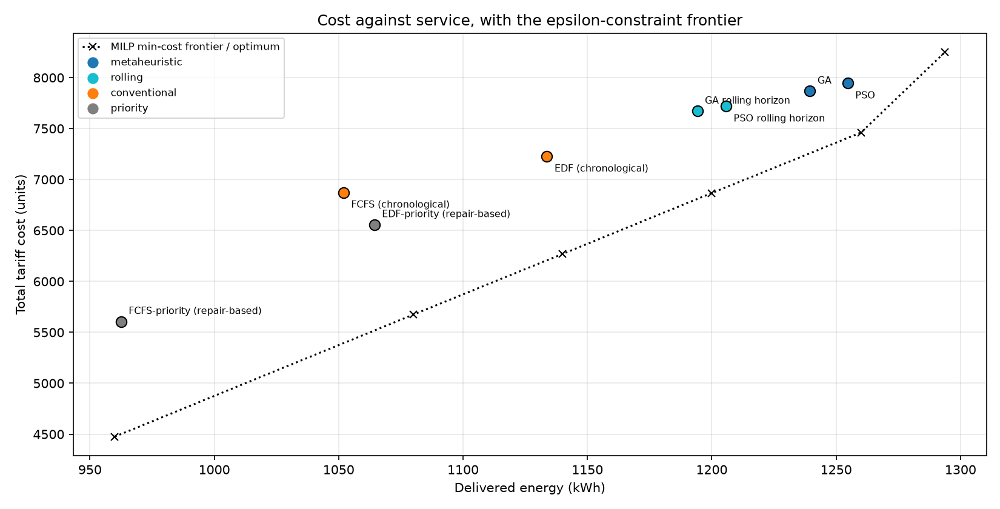
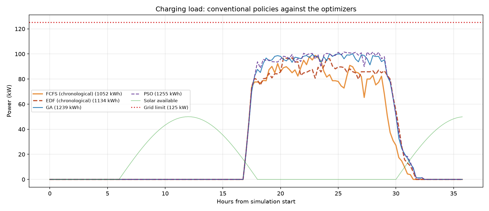
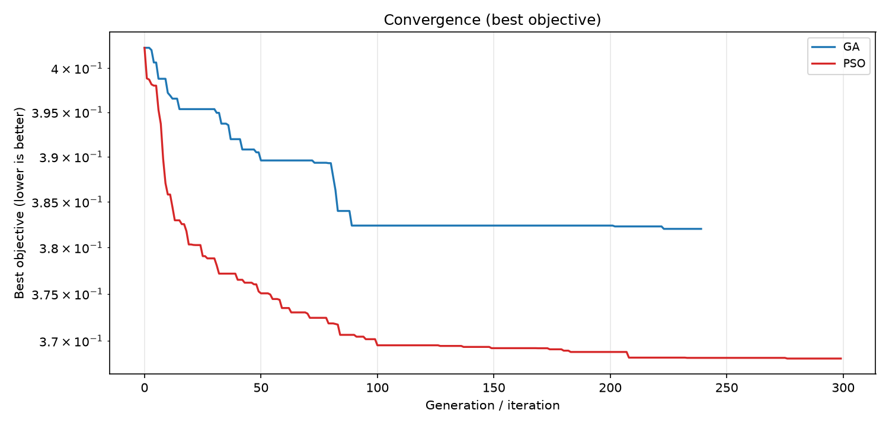
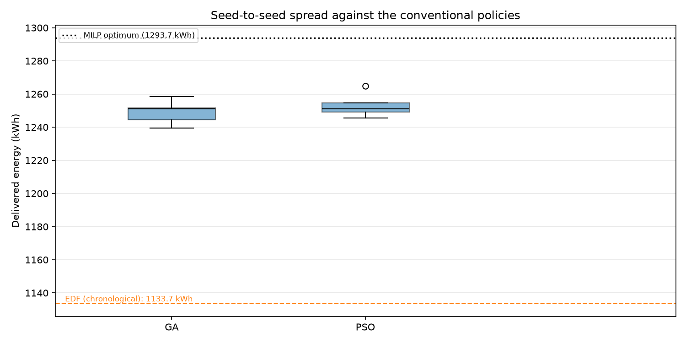

# Tier 2 changes — making the metaheuristics actually optimize

**Scope of Tier 2:** Tier 0 items 7–11, plus the objective re-normalisation Tier 1
deferred (item 3), which turned out to be a prerequisite rather than a separate
job — an objective that is 96% unmet energy cannot reward a cheaper schedule, so
"make the search better" is meaningless until the search has something to aim at.

| Tier 0 item | Status |
|---|---|
| 7. Replace the 14,400-gene encoding | **done** — 4 genes per EV (400 total) |
| 8. No "fill remaining capacity" stage, plus memetic local search | **done** — the decoder is feasible by construction, and a hill-climbing polish runs on the best genome |
| 9. Give PSO a representation where a step is meaningful | **done** — random-key PSO on the same genome |
| 10. Add an LP/MILP reference optimum | **done** — `src/reference_optimum.py`, HiGHS via SciPy |
| 11. Report real budgets (10⁴–10⁵ evaluations) | **done** — 12,680 (GA) / 13,030 (PSO), asserted in tests |
| Tier 1 item 3. Re-normalise the objective | **done** — cost is now an intensity, weight raised |

**Reproduce (~25–30 min, machine-dependent):**

```bash
cd EV-charging
.venv/Scripts/python src/run_final_experiments.py --multi-seed
.venv/Scripts/python -m pytest tests -q
```

`--reuse-reference` reuses a `reference_optimum.csv` solved on the same inputs
instead of re-solving the six MILPs; `--reference-time-limit` caps each solve.

---

## 1. The question Tier 2 had to settle

Tier 0 and Tier 1 established that **EDF beat both metaheuristics**: 1,133.7 kWh
against the GA's 1,116.1 kWh, through one evaluator and one repair routine. That
finding had an obvious alternative explanation, which Tier 0 wrote down itself:

> Replace the encoding. 14,400 genes with 560 evaluations is hopeless, and the
> genome controls only ~32% of the ranking score because the repair routine's own
> weights total 0.95.

So the Tier 0/1 result was not evidence that genetic algorithms are weak — it was
evidence that *this search* was weak. Tier 2 rebuilds the search and adds a
benchmark, so the question stops being "who beat whom" and becomes "how far is
each method from the best schedule that exists".

## 2. What changed

| File | Change |
|---|---|
| `src/genome.py` | **New.** The 400-gene genome, the feasible slot-major decoder, four warm starts and the memetic hill climber. |
| `src/multiobjective_optimizers.py` | **Rewritten.** GA and random-key PSO over the genome, both with an exactly-counted memetic polish. The priority-matrix search is gone. |
| `src/multiobjective_core.py` | Objective: the cost term is now **cost per delivered kWh**, not cost as a fraction of `required × peak tariff`. Weights re-tuned in `config.py`. |
| `src/reference_optimum.py` | **New.** MILP max-service optimum, ε-constraint min-cost frontier, rigorous capacity bounds, and the optimality-gap columns. |
| `src/artifacts.py` | Five new figures; `file_digest` moved here so the reference rows can carry their own provenance. |
| `src/run_final_experiments.py` | Builds `service_vs_optimal.csv`, solves or reuses the reference, draws the new figures and prints a verdict. |
| `src/run_rolling_horizon.py` | The controller now runs the genome optimizer; the memetic budget is disabled inside a 24-slot window (144 replans × 4,000 evaluations would be absurd). |
| `src/config.py` | 10⁴-scale budgets, new objective weights, reference solver settings. |
| `tests/test_genome.py`, `tests/test_reference_optimum.py` | **New.** 20 + 14 tests. |
| `requirements.txt` | `scipy==1.16.2` (only `scipy.optimize.milp`, which ships HiGHS — no separate solver). |

## 3. The genome: four numbers per EV

The old genome was a `(n_ev, n_slots)` priority matrix — 14,400 numbers, each of
which moved one cell of a schedule that is produced by a greedy repair. The new
one is four numbers per EV:

| Gene | Range | Meaning |
|---|---|---|
| `rank` | [0, 1] | base priority when more EVs want a port than there are ports |
| `urgency` | [0, 3] | weight on deadline pressure `remaining / (slots_left × rated_power)` |
| `tariff` | [0, 3] | weight on the normalised time-of-use price |
| `power` | [0, 1] | charging rate as a fraction of rated power |

The decoder walks the horizon slot by slot. In each slot it scores the connected
EVs with energy left,

```
score = rank + urgency · urgency(t) − tariff · price(t)
```

and gives the ports to the highest-scoring EVs until the ports, the grid capacity
or the remaining energy run out. **An EV with a negative score is deferred.**

That sign rule is the whole trick, and it is worth being precise about it, because
it is what makes the genes interpretable:

* `rank` and `urgency` can only *add* to a score, `tariff` can only *subtract*.
* So an EV charges whenever it has any reason to, and waits only when the current
  slot's price outweighs both its base priority and its deadline pressure.
* There is no separate "start slot" gene and no separate "defer" flag: waiting is
  expressed by the same three numbers that express everything else.

Consequences that matter:

* **Feasibility is structural.** The decoder never places power outside a
  connection window, never exceeds rated power or remaining energy, never uses
  more than 20 ports and never exceeds `125 kW + solar`. There is no repair stage,
  no penalty term and no "fill remaining capacity" pass.
* **A small step is a small change.** One gene is one decision about one EV, so a
  mutation or a velocity component perturbs the schedule locally. That is exactly
  what the priority-matrix PSO lacked (Tier 0 item 9).
* **Warm starts are disclosed.** The initial population contains four structured
  genomes (`power`, `deadline`, `need`, `arrival` rankings, all charging at rated
  power with a moderate tariff weight). Both optimizers get the same four, so
  neither starts from a better place. Their services are 1,165.7 / 1,130.2 /
  1,102.3 / 1,161.6 kWh: the best one alone already beats EDF by 32.0 kWh, and the
  GA then finds another 73.8 kWh on top of it. The search earns most of the gain,
  but it does not start from a strawman.
* **What it cannot do:** the decoder is greedy and chronological, so it cannot
  look ahead. It is a decoder, not an optimiser, and §6 quantifies what that costs
  against the MILP.

## 4. Budgets, and why the mutation rate was tuned

| | GA | PSO |
|---|---|---|
| initial population | 40 | 30 particles |
| per generation / iteration | 240 × 36 children | 300 iterations |
| memetic polish | 4,000 | 4,000 |
| **total objective calls** | **12,680** | **13,030** |

Both counts are exact: the local search returns the number of evaluations it
used, and `tests/test_optimizers.py` checks the arithmetic against the
optimizers' real behaviour. `tests/test_config.py` refuses a budget below 10⁴.

The mutation rate is not a leftover. With the Tier 0/1 value of `0.08` and two
elites, a 400-gene genome gets about 32 genes re-drawn per child, which destroys
whatever made the parent good: that run delivers **1,174 kWh**. With `0.02` and
four elites the same 12,680 evaluations deliver **1,239.5 kWh**. The memetic budget
matters too, but less: raising the polish from 1,000 to 4,000 evaluations adds
**9.3 kWh** (1,230.2 → 1,239.5). All three figures were measured on the full
budget at a single seed before the settings were fixed.

## 5. The objective had to be fixed first

The cost term used to be

```
cost_n = grid_cost_units / (required_energy_kwh × 10)      → every schedule 0.47–1.00
```

That is a volume ratio, not a price: it moves with how much energy a schedule
delivers, and at a 6% weight it could not express a preference. Tier 1 saw the
consequence directly — the objective ranked GA rolling horizon 2nd of 9 while
that row was strictly dominated on service, cost per kWh *and* peak.

It is now an intensity:

```
cost_n = (grid_cost_units / delivered_energy_kwh) / TARIFF_PEAK
```

with weights `unmet 0.55, cost 0.30, peak 0.08, battery 0.02, solar 0.05`
(was `0.80 / 0.06 / 0.07 / 0.02 / 0.05`). Service still leads, because a schedule
that serves less is not a schedule, but cost is now worth 30% of the score and is
measurable in the units it is priced in.

## 6. The reference optimum: how much is actually achievable?

`src/reference_optimum.py` solves the scenario as a MILP with HiGHS. Only the
port limit is combinatorial, so the model needs one binary per feasible
(EV, slot) pair — 3,703 of the 14,400 — and solves in seconds to ~40 s.

### 6.1 Two rigorous ceilings that need no solver

| Bound | kWh | What it relaxes |
|---|---|---|
| per-EV: `Σ min(required, window × rated power)` | 1,511.3 | the port limit and the grid |
| per-slot: `Σ min(125 kW + solar, Σ 20 largest rated powers)` | 1,535.5 | the coupling between slots |
| **upper bound (min of the two)** | **1,511.3** | |

And the resource that actually binds:

```
port-hours available  268.0 h   (Σ_t min(EVs connected, 20) × 0.25 h over 62 occupied slots)
port-hours needed     342.0 h   (Σ_i attainable_i / rated_power_i)
```

Ports, not the grid and not the energy request, are what limit this scenario. That
is the structural fact the conventional policies never exploit.

### 6.2 The optimum, and the frontier

| Reference point | Delivered kWh | Total cost | cost/kWh | Fully charged | Solve |
|---|---|---|---|---|---|
| Min cost at 960 kWh | 960.0 | 4,476.2 | 4.663 | 24 | optimal, 9 s |
| Min cost at 1,080 kWh | 1,080.0 | 5,673.9 | 5.254 | 34 | optimal, 24 s |
| Min cost at 1,140 kWh | 1,140.0 | 6,269.5 | 5.500 | 40 | optimal, 26 s |
| Min cost at 1,200 kWh | 1,200.0 | 6,867.2 | 5.723 | 39 | optimal, 27 s |
| Min cost at 1,260 kWh | 1,260.0 | 7,461.3 | 5.922 | 44 | optimal, 41 s |
| **Max service** | **1,293.7** | 8,249.6 | 6.377 | 32 | optimal, 6 s |

Two things to read off it:

* **The margin is nearly constant at ~10 units/kWh** — the peak tariff — all the
  way to 1,260 kWh. Extra energy has to be bought during the expensive evening
  hours once the cheap overnight slots are full.
* **The last 33.7 kWh cost 23.4 units/kWh**, because they can only be delivered
  by charging at the grid limit in the slots that remain. The service-maximum
  schedule is the *most expensive* point on the frontier, which is why the
  optimizers are compared at equal service, not at equal cost.

Also note the fully-charged column: the max-service optimum completes **32** EVs,
fewer than the 1,140 kWh point's **40**. Total energy and completion count are not
the same objective (see §7.3).

## 7. Results

### 7.1 The optimizers now beat every conventional policy

| Method | Delivered kWh | % of required | % of best known | Total cost | cost/kWh | Peak kW | Fully charged | Evaluations |
|---|---|---|---|---|---|---|---|---|
| **PSO** | **1,254.7** | **82.89** | **97.0** | 7,944.7 | **6.332** | 101.5 | 25 | 13,030 |
| **GA** | **1,239.5** | **81.89** | **95.8** | 7,868.0 | 6.348 | 100.2 | 16 | 12,680 |
| PSO rolling horizon | 1,205.7 | 79.66 | 93.2 | 7,718.7 | 6.402 | 105.2 | 4 | — |
| GA rolling horizon | 1,194.2 | 78.90 | 92.3 | 7,671.0 | 6.424 | 104.9 | 5 | — |
| EDF (chronological) | 1,133.7 | 74.91 | 87.6 | 7,226.7 | 6.374 | 96.9 | **61** | 0 |
| EDF-priority (repair-based) | 1,064.4 | 70.32 | 82.3 | 6,556.4 | 6.160 | 97.1 | 60 | 0 |
| FCFS (chronological) | 1,052.0 | 69.50 | 81.3 | 6,873.0 | 6.533 | 98.9 | 62 | 0 |
| FCFS-priority (repair-based) | 962.5 | 63.59 | 74.4 | 5,605.8 | 5.824 | 96.1 | 60 | 0 |
| *MILP reference* | *1,293.7* | *85.47* | *100.0* | *8,249.6* | *6.377* | *109.2* | *32* | *—* |

Evaluation counts for the two rolling rows are not tracked (`—`): the controller
reports one metric row for 144 replans, so its budget is 144 × 38 ≈ 5,500 calls by
construction rather than by measurement.

The headline: **PSO delivers 120.9 kWh (+10.7%) and the GA 105.7 kWh (+9.3%) more
than the best conventional policy, through the same evaluator and under the same
constraints.** Against the reference optimum they reach 97.0% and 95.8% of the best
known service. In Tier 0/1 the optimizers lost to EDF by 17.7 kWh; the difference
was the search, exactly as Tier 0 suspected.

### 7.2 At equal service, they are also cheaper

Total cost is a volume metric, so the comparison is the gap to the cheapest
schedule known to deliver the *same* energy, interpolated on the ε-frontier:

| Method | Delivered | Cheapest known at that service | Its cost | Gap |
|---|---|---|---|---|
| PSO | 1,254.7 | 7,408.4 | 7,944.7 | **+7.2%** |
| GA | 1,239.5 | 7,258.2 | 7,868.0 | **+8.4%** |
| GA rolling horizon | 1,194.2 | 6,809.3 | 7,671.0 | +12.7% |
| PSO rolling horizon | 1,205.7 | 6,923.9 | 7,718.7 | +11.5% |
| EDF (chronological) | 1,133.7 | 6,207.3 | 7,226.7 | **+16.4%** |
| EDF-priority (repair-based) | 1,064.4 | 5,517.9 | 6,556.4 | +18.8% |
| FCFS (chronological) | 1,052.0 | 5,394.3 | 6,873.0 | +27.4% |
| FCFS-priority (repair-based) | 962.5 | 4,501.5 | 5,605.8 | +24.5% |

Read the caveat with the number: the reference cost at an intermediate service is
a **chord between solved levels**, not a solved optimum. The frontier is almost
linear to 1,260 kWh and steepens after, so the interpolation error is small below
1,260 and the gaps for GA/PSO are, if anything, slightly optimistic. The claim
that survives is the ordering, not the third digit: PSO is about half as far from
the cheapest possible schedule as EDF is.

### 7.3 Two things the optimizers do *not* win

**They do not complete more EVs.** EDF fully charges 61 of 100; the GA 16, PSO 25,
and the max-service MILP only 32. Maximising total energy rewards charging
high-power EVs fully and leaving low-power ones with nothing, because a port spent
on a 1 kW EV yields a quarter of the energy of the same port-hour on a 7 kW EV.
This is a real trade-off, not a rounding artefact, and it is why the table reports
`fully_charged_evs` next to the energy column. A utility that cares about "every
driver leaves with a full battery" would not rank these schedules this way, and a
fairness-weighted objective is listed as deferred work in §10.

**They do not reduce the peak.** GA peaks at 100.2 kW and PSO at 101.5 kW against
EDF's 96.9 kW and FCFS's 98.9 kW. Serving 10% more energy through 20 fixed ports
means running the site harder; the reference optimum itself peaks at 109.2 kW. The
peak objective keeps its 8% weight, but no reader should take these numbers as
evidence of peak shaving — Tier 1 already showed the metric is nearly inert here.

### 7.4 Seed spread

Five seeds per optimizer, full budget, same settings (seeds 42–46):

| Method | Delivered kWh (mean ± std) | Worst seed | Best seed | Cost units (mean ± std) |
|---|---|---|---|---|
| PSO | 1,253.1 ± 7.3 | 1,245.6 | 1,264.7 | 7,906.9 ± 30.7 |
| GA | 1,249.0 ± 7.3 | 1,239.5 | 1,258.4 | 7,899.7 ± 65.8 |
| EDF (chronological) | 1,133.7 (deterministic) | 1,133.7 | 1,133.7 | 7,226.7 |

Every one of the ten runs beats EDF, the worst by **+105.8 kWh**, and the seed
spread (±7 kWh, ~0.6%) is an order of magnitude smaller than the gap to any
conventional policy. The result is not a lucky draw.

A related detail: the two optimizers are close enough that their seed spreads
overlap (GA's best run is 1,258.4 kWh, PSO's worst 1,245.6 kWh). The claim is
that both are far better than the conventional policies and near the reference
optimum, not that one of them is reliably better than the other.

## 8. The figures

`results/final_unified/service_vs_methods.png` — delivered energy per method, with
the best conventional policy and the MILP optimum as vertical lines:



`results/final_unified/cost_vs_service.png` — every method on (service, total cost)
against the ε-constraint frontier. Points above the dotted line pay more than the
cheapest known schedule for the energy they deliver:



`results/final_unified/comparison_load_profiles.png` — why the optimizers win: the
conventional policies hold the site at 78–92 kW for the whole evening, while GA and
PSO hold it at 92–101 kW, and the 125 kW cap is never reached by any of them:



`results/final_unified/convergence_comparison.png` — best objective per generation
and per iteration, on a log axis:



`results/final_unified/multi_seed_spread.png` — delivered energy over the five
seeds against the conventional policies and the optimum:



## 9. Verification

* **The MILP is checked against the project's own constraints.** Every solved
  schedule is passed through `constraint_report` before it is returned. That check
  earned its place during development: the first version of the model folded the
  linking rows (`s ≤ rated_power × port`) into the grid rows, which silently
  removed the port constraint and produced a "feasible" 1,511 kWh optimum that used
  36 ports in a slot with 20. The tests now pin the port limit directly
  (`test_port_limit_reduces_the_optimum`: one port 1 kWh, two ports 2 kWh).
* **Every reference row carries its provenance** — scenario and solar digest,
  solver status, MIP gap and solve time — and the committed file is checked against
  the current inputs, so a stale optimum cannot price a regenerated scenario.
* **The optimizers' budgets are asserted, not described.**
  `test_ga_and_pso_used_the_configured_full_budget` recomputes 12,680 / 13,030 from
  the settings, and `test_evaluation_budget_arithmetic` pins the memetic arithmetic.
* **The genome is tested for feasibility everywhere**, including the degenerate
  cases: an all-zero genome, an EV with an empty window, zero rated power, a
  3 kW site with 2 ports.
* **The headline claim is a test, not a paragraph.**
  `test_the_optimizers_beat_every_conventional_policy` fails if either optimizer
  stops delivering more energy than any FCFS/EDF row.
* **No method can beat the frontier** by more than the solver's tolerance
  (`test_committed_gaps_are_physically_possible`), which would otherwise indicate a
  modelling error or an infeasible schedule.

Test suite: **155 passed, 2 skipped, 0 failed** (`pytest tests -q`, exit 0). The two
skips are the raw-ACN-data tests, which need a dataset that is not committed.

## 10. Deferred, and what Tier 2 does not fix

1. **Fairness is not in the objective.** §7.3 shows the cost of ignoring it:
   total-energy optimisation leaves some EVs unserved. A max-min or
   service-floor-per-EV objective would give a different and arguably more useful
   frontier, and it needs its own reference solve.
2. **The grid still has no base load** (Tier 1 item 2). `P_grid = P_ev − P_solar`,
   not `P_base + P_ev − P_solar`, so the 125 kW cap constrains EV load only. With
   the optimizers now pushing to 100–110 kW this matters more than it did in Tier 1.
3. **The scenario has no slack** (Tier 1 item 5). The MILP shows the ceiling is
   set by 268 port-hours; a scenario with more ports would let scheduling quality
   matter over a wider range instead of saturating.
4. **The solar term is still inert** (Tier 1 item 4). Only 43.8 of 566.5 kWh of PV
   coincides with a connected EV, so the 5% solar weight is a constant.
5. **The ε-frontier is a chord.** Exact cost-of-service comparisons need a solve at
   each method's service level, not an interpolation between levels.
6. **The rolling controller is still a weak baseline** — 8 individuals, 5
   generations per window, no memetic pass. It is reported as a controller, not as
   a tuned optimizer, and it now loses to the one-shot runs.
7. ~20 one-off `analyse_*`/`audit_*`/`compare_*` scripts remain in `src/`; the raw
   ACN dataset is still not committed.

## 11. Test and run record

From the run that produced the artifacts in this revision. See
`results/final_unified/run_manifest.csv` for the exact provenance: mode `full`,
rolling horizon enabled, multi-seed enabled, GA settings
`population_size=40, generations=240, polish_evaluations=4000`, PSO settings
`particles=30, iterations=300, polish_evaluations=4000`, and input hashes
`658fcc66a11fcef0` (scenario) / `63dba68e5466b222` (solar).

```
GA  : 57.1 s, 12,680 evaluations, objective 0.371970, 1,239.487 kWh
PSO : 58.3 s, 13,030 evaluations, objective 0.366864, 1,254.652 kWh
Reference: 6 MILPs, all optimal, 5.8 / 9.2 / 23.7 / 25.5 / 26.6 / 41.0 s,
           MIP gap <= 1.0% on every row
155 passed, 2 skipped in 7.72s
```

Timings are machine-dependent and, as Tier 1 noted, not comparable between runs;
the committed numbers are deterministic given the seeds.

**A note on how the artifacts were produced.** The pipeline ran end to end once
with `--multi-seed`. The three figures whose layout was changed afterwards
(`service_vs_methods.png`, `comparison_load_profiles.png`, `multi_seed_spread.png`)
and `service_vs_optimal.csv` (which gained the evaluation column) were then rebuilt
from the committed `schedules.npz`, `reference_optimum.csv` and
`multi_seed_results.csv` by calling the same functions; re-running the documented
command reproduces them identically.
